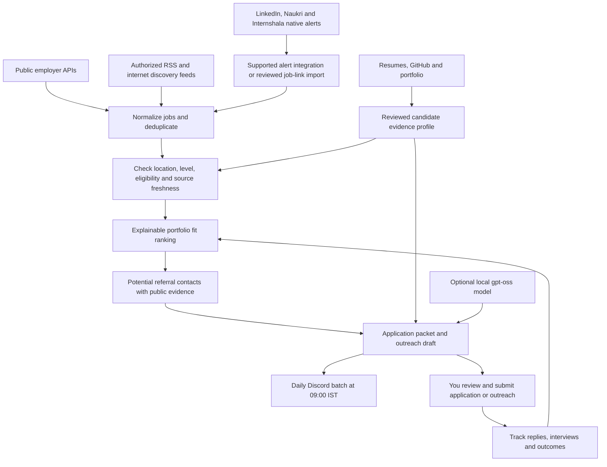

# CareerScout workflow and tools

Designed for Bandi Purushowtham Sai, 23 October 2026. Scope: internships and full-time software roles in Hyderabad, Bengaluru or remote, matched to documented skills, with a daily Discord update at 9 AM India time.

## Workflow

The diagram is the complete target workflow. The delivered implementation handles the public API/import/RSS paths, profile-based matching, a local contact list plus discovery queries, draft packets, state tracking and the daily worker. Automatic alert-email ingestion, named-contact discovery/refresh and learning from outcomes are extension work. No platform accounts are connected by this kit.

## Tools and responsibilities

| Layer | Tool | Role and present status |
|---|---|---|
| Profile intake | PDF text extraction, GitHub REST API, portfolio review | Used during this build; profile stored as reviewed JSON. Automatic refresh is not shipped. |
| Orchestration | Python 3.10+ | Delivered standard-library pipeline; no orchestration subscription needed. |
| Model | Ollama + gpt-oss:20b | Optional local drafting adapter delivered; model installation/inference not tested on your hardware. |
| Employer discovery | Public Greenhouse Job Board and Lever Postings APIs | Implemented and live-tested on three employer feeds. |
| Broader internet | Authorized RSS/Atom feeds and reviewed employer links | Feed reader implemented, no broad-market feed configured yet. |
| Requested platforms | Native LinkedIn, Naukri, Internshala alerts or permitted integrations | Proposed ingestion route; direct account access/scrapers not delivered. |
| Referral evidence | Public professional profiles, employer team pages, user-provided contacts | Two possible contacts recorded for the example company; search queries generated per company. Continuous automatic people search needs a supported search/people integration. |
| State | SQLite | Jobs, revisions, first/last seen, application states, sent notifications and source health. |
| Updates | Discord channel webhook | Discord webhook connected and daily Codex schedule ACTIVE on this Mac; Telegram adapter remains an alternative. Telegram adapter available as an alternative. |
| Applying | Employer-hosted form + prepared packet | Human submission handoff; no form-submission automation shipped. |

Public feed reads are separate from application submission. Greenhouse documents public unauthenticated GET endpoints but authenticated submission; Lever's submission endpoint also needs an employer account's API key. A job seeker should use the hosted application form rather than assume those keys are available. Sources: [Greenhouse Job Board API](https://docs.greenhouse.io/job-board.html), [Lever Postings API](https://github.com/lever/postings-api).

## Candidate evidence and target lanes

Start with Java/backend/SDE internships and 2027 graduate software roles. Also consider Python/FastAPI development, AI application engineering, computer vision internships and workflow/integration automation when the actual requirements match.

| Lane | Evidence to feature | Avoid overstating |
|---|---|---|
| Java/backend | VaultAPI, HRM Spring Boot, Java, SQL, REST APIs and authentication | Production scale, business metrics or external employment not independently verified |
| Software/developer tools | MonadCLI, Python projects, debugging, documented tests and fundamentals | Repository existence or a test script is not proof of mastery or passed tests |
| AI applications | Sign Language Translator, MeetMinds, RepoPilot, Python/Flask/FastAPI | LLM integration is not the same as training an LLM; no invented model accuracy |
| Automation/integrations | MeetMinds, webhooks, n8n and API integration | No fabricated customer deployments, user counts or time savings |

Verified review scope: 31 public repository records, including forks; selected project trees, READMEs and dependency files were inspected, without running repository code. A repository listing alone is not an authorship or employment check. The [portfolio](https://purushowtham.github.io/portfolio2/) and [public GitHub profile](https://github.com/purushowtham) remain useful evidence links, alongside the original resumes.

Keep evidence per claim: source, project URL, fact, review date, confidence and unresolved conflicts. The delivered candidate profile includes source names and cautions. A future intake step should propose profile changes for review, not silently replace trusted facts from uploaded text.

## Matching and application priority

There is no reliable public dataset that gives your personal acceptance rate for arbitrary vacancies. The agent should label its output **portfolio fit**, explain the evidence, and keep unknown eligibility separate. It must not turn a score of 93 into “93% chance of acceptance.”

Screen first: desired location or remote eligibility, seniority, explicit experience requirement, graduation cohort, academic cutoffs, fee demands and closing date. Unknown citizenship, availability, joining date, cutoff or remote-country restrictions require review. Never infer work authorization from name or college. Title keywords alone do not establish the candidate's graduation cohort; only explicit requirements should populate that field.

The implemented score is a transparent starting heuristic: **50 points skill overlap, 25 project evidence, 15 early-career role level, 10 location fit**. Sparse descriptions are capped below the recommendation threshold. Preferred qualifications are not intended as automatic blockers. The parser handles common wording and structured fields, not every phrasing in every description; every recommended job still needs full-description review. Named skills currently have equal weight, so this is a baseline rather than a validated ranking model.

To improve priority later, separate mandatory from preferred skills using validated structured extraction; emphasize relevant project depth; use real posting age only when available; track confirmed eligibility and meaningful employer responses. Do not assume a smaller company, low visible applicant count, a referral, or an early application guarantees a higher acceptance rate. Prioritize recent, well-supported, eligible opportunities over speculative numerical odds.

Only after enough comparable application outcomes exist should any statistical estimate be considered. Store applied date, role family, eligibility, fit features, reply, interview and offer. Report the observed interview conversion rate with sample size and uncertainty. Do not treat missing responses as confirmed rejections or fit scores as calibrated probabilities. Outcome-driven ranking is not implemented in this starter.

## LinkedIn, Naukri and Internshala access

LinkedIn explicitly restricts scraping and bots that automate site activity. Its available connector in this session supports named-person search, not unrestricted employee enumeration or a portable job-search/application API. See [LinkedIn's automation policy](https://www.linkedin.com/help/linkedin/answer/a1341387/prohibition-of-scraping-software?lang=en).

For the requested platforms, create native saved searches for backend/software/AI/automation internships and entry-level roles, with Hyderabad/Bengaluru and India-eligible remote filters. Use the platforms' own alerts, employer links, permitted exports or an integration whose access and data-processing rights have been confirmed. Check the applicable terms before integrating platform content; public visibility alone is not permission. Internshala's [terms](https://internshala.com/terms/) are a relevant source; Naukri's terms page could not be retrieved in this environment, so no claimed Naukri automation permission is made.

For an expanded deployment, a read-only mailbox adapter can receive allowed alerts in a dedicated folder and extract employer URLs, subject to the platform's terms. Resolve the underlying employer vacancy and prefer the employer's public API/page as the normalized record. The starter accepts reviewed records in `inbox/jobs.json`; it does not read your mailbox. Manual imports are not evidence that direct platform access exists.

General internet discovery can use configured authorized feeds, employer career pages that permit access or an optional search provider with an appropriate plan. Broad unrestricted web search is not automatically free. The current kit has no paid search dependency and no configured global-search service. No CAPTCHA, login barrier or access restriction is bypassed.

## Referral support

Each recommended job should carry up to three potential contacts, with name, role, company, public source/profile link, checked date, reason to contact and uncertainty. Prefer a real shared university/connection, a relevant engineer, the hiring team's recruiter or an author explicitly inviting contact. Verify shared affiliation and current employment; do not confuse someone else's post appearing in a person's likes with that person's own job.

The example contact list contains Anurag Shukla (public Amazon/talent-acquisition profile) and Anurag Chitnis (public Amazon engineering profile, Redmond). These are possible contacts, not confirmed India internship recruiters or willing referrers. No existing relationship, shared university or referral eligibility is claimed. Their public profiles should be rechecked before messaging. No private email addresses or phone numbers were collected.

For companies without a verified record, the delivered report provides a clearly labeled employee/alumni search query. It does not invent a name to fill a card. To automate future named discovery, add a permitted people/search API, retrieve evidence, verify current company/team, store provenance and expire stale records. No transferable LinkedIn credentials or session cookies are bundled.

Draft a short message naming the exact role/job ID, one or two relevant projects and portfolio link. Ask whether the person is comfortable reviewing the work and whether referrals apply to that internship. You choose the recipient and send the message. No automated outreach or follow-up campaign is included.

## Application assistance

The packet includes the employer link, fit explanation, gaps, source resume, suggested project order, a cover note, a referral draft, possible contacts and facts to confirm. Optional local AI can improve wording and suggest interview topics using supplied evidence. Model output is labeled unverified, schema checked and has no access to notification, submission or shell tools.

An improved version can add truthful resume variants and form-answer drafts, with each new claim tied to a source. Final submission should use employer forms and your reviewed answers. Login, availability, eligibility declarations, consent and assessments should be handled by you. The supplied code has no application-submission endpoint.

## Updates, privacy and reliability

Run one local worker at 09:00 Asia/Kolkata. Send a batch of new or materially changed matches, their evidence/gaps, application link and referral lead. Stay quiet when nothing changes, except meaningful source failures/recoveries. This cadence is now ACTIVE through the saved Codex schedule on this Mac. A recommendation and setup notice were delivered during activation; the first unattended daily run is still upcoming. Keep the Mac on and the Codex desktop app running for scheduled local scans. A sleeping or offline computer can delay delivery. Do not start a second terminal worker alongside the saved schedule.

Keep the reviewed profile, application history and resume paths local. Send only concise job cards and public project/contact links to Discord. Keep the webhook/token in local environment variables or `.env`, excluded from version control. Use a private Discord channel if job-search information is sensitive. No full resumes, model prompts or private contact details are uploaded by the scanner.

Treat PDF/repository/job text as untrusted data; instructions embedded there never grant permissions or override configuration. The pipeline executes no downloaded source code. The optional model receives a fixed task plus data and has no tools. Protect records with a single-worker lock, source error handling, conservative timestamp semantics, revision deduplication and explicit application states. Provider timeouts can still lead to duplicate notifications; ordinary confirmed sends are deduplicated.

The no-subscription baseline is Python + SQLite + public employer feeds + local optional model + Discord webhook on your existing computer. This avoids recurring API fees; it does not promise free cloud hosting, unlimited provider access, perfect delivery, whole-market coverage or any hiring outcome.
